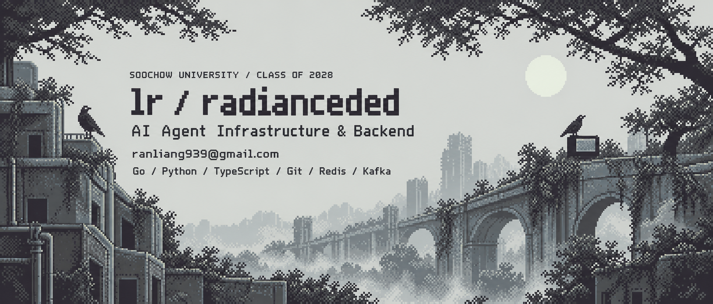

  

  苏州大学软件工程本科生，关注 AI Agent 基础设施与后端开发。 
  参与过语义缓存、保险 Agent 和真实业务系统的开发与交付。

  <a href="mailto:ranliang939@gmail.com">ranliang939@gmail.com</a>
  &nbsp; · &nbsp;
  <a href="https://github.com/radianceded?tab=repositories">Repositories</a>
  &nbsp; · &nbsp;
  Soochow University · Class of 2028

  <a href="#selected-work">Selected Work</a> &nbsp; / &nbsp;
  <a href="#open-source">Open Source</a> &nbsp; / &nbsp;
  <a href="#in-progress">In Progress</a> &nbsp; / &nbsp;
  <a href="#toolkit">Toolkit</a>

---

## Selected Work

01—03 / AGENT INFRASTRUCTURE · APPLIED AI · PRODUCT ENGINEERING

 

让 Agent 复用跨会话的知识与工作流，减少重复探索和上下文开销。

**我的参与** · 上下文复用策略开发与实验验证。  
**关注的问题** · 记忆复用的适用边界、执行开销与结果质量。

[浏览源码 →](https://github.com/Gnosil/semantix) &nbsp; · &nbsp; [查看我的提交 →](https://github.com/Gnosil/semantix/commits/main/?author=radianceded)

 

面向保险业务中的信息提取与结构化处理，提升模型输出的可用性。

**我的参与** · LLM 结构化输出校验与基于原文证据的保额纠错。  
**关注的问题** · 数字漏位、单位归一化、主／子限额混淆，以及证据冲突时的保守处理。

PRIVATE REPOSITORY / 仅展示项目概要

 
 

结合参与者位置与出行方式，检索候选地点并比较通勤成本，让多人聚会选址更公平。

**核心能力** · 地图检索、路线规划，以及综合通勤时间与公平性差值的排序。  
**接入方式** · FastAPI、MCP Server 与聊天插件。

[浏览源码与文档 →](https://github.com/radianceded/Gathere)

 

---

## Open Source

CONTRIBUTIONS / 代码、实验与产品改进

### 已合并 / Merged

| Project | Contribution | PR |
| :--- | :--- | :--- |
| [Gnosil/semantix](https://github.com/Gnosil/semantix) | 模型嵌入接入、CLI 配置命令、上下文复用实验及桌面端迭代 | [#106](https://github.com/Gnosil/semantix/pull/106) · [#137](https://github.com/Gnosil/semantix/pull/137) · [#513](https://github.com/Gnosil/semantix/pull/513) · [#487](https://github.com/Gnosil/semantix/pull/487) |
| [prometheus/client_golang](https://github.com/prometheus/client_golang) | 微基准迁移到 `b.Loop`，统一基准用例命名 | [#2114](https://github.com/prometheus/client_golang/pull/2114) |
| [zzet/gortex](https://github.com/zzet/gortex) | 修正模型价格配置及费用计算 | [#786](https://github.com/zzet/gortex/pull/786) |
| [ensureok-startup-collector](https://github.com/Allenli1233/ensureok-startup-collector) | AI 风险报告、热力图及详情页体验 | [#19](https://github.com/Allenli1233/ensureok-startup-collector/pull/19) · [#18](https://github.com/Allenli1233/ensureok-startup-collector/pull/18) |
| [Gnosil/bazi-anima](https://github.com/Gnosil/bazi-anima) | 增加角色精灵资源 | [#5](https://github.com/Gnosil/bazi-anima/pull/5) |

<strong>进行中 / Open PRs</strong> — 展开查看 Cherry Studio、OpenViking、AgentScope、GoFr 与 DeepSeek-Reasonix

| Project | Proposed contribution | PR |
| :--- | :--- | :--- |
| [CherryHQ/cherry-studio](https://github.com/CherryHQ/cherry-studio) | 为 `~/.agents/skills` 同步增加按技能选择开关 | [#20356](https://github.com/CherryHQ/cherry-studio/pull/20356) |
| [volcengine/OpenViking](https://github.com/volcengine/OpenViking) | 修复删除后的摘要刷新，以及 Windows 辅助文件 URI 路径处理 | [#6201](https://github.com/volcengine/OpenViking/pull/6201) · [#5531](https://github.com/volcengine/OpenViking/pull/5531) |
| [agentscope-ai/agentscope](https://github.com/agentscope-ai/agentscope) | 增加 RealtimeAgent 上下文用量观测层 | [#2838](https://github.com/agentscope-ai/agentscope/pull/2838) |
| [gofr-dev/gofr](https://github.com/gofr-dev/gofr) | 在 gRPC 指标标签中记录状态码 | [#4349](https://github.com/gofr-dev/gofr/pull/4349) |
| [Gnosil/DeepSeek-Reasonix](https://github.com/Gnosil/DeepSeek-Reasonix) | 增加 Semantix Design 主题 | [#4](https://github.com/Gnosil/DeepSeek-Reasonix/pull/4) |

状态核对：2026-10-20。以上为精选记录；[完整公开 PR 清单](docs/open-source.md) 包含个人项目、课程资料，以及已关闭未合并的提案。

 

---

## In Progress

WORKBENCH / 从基础开始构建

### Go 直播弹幕后端

> **学习与开发中**  
> 从零手写，逐步实现长连接管理、多房间广播与异步持久化，记录设计取舍和性能验证。

`Go` · `WebSocket` · `Redis` · `Kafka` · `MySQL`

业务参考：[live-stream-danmaku](https://github.com/charlesAcmen/live-stream-danmaku)。以上为阶段目标，不代表已完成的功能或性能成果。

 

---

## Toolkit

LANGUAGES / TOOLS / MIDDLEWARE

  
  
  
  
  
  

 

---

## Contribution Map

<picture>
  <source media="(prefers-color-scheme: dark)" srcset="https://raw.githubusercontent.com/radianceded/radianceded/output/github-snake-dark.svg" />
  <source media="(prefers-color-scheme: light)" srcset="https://raw.githubusercontent.com/radianceded/radianceded/output/github-snake.svg" />
  
</picture>
