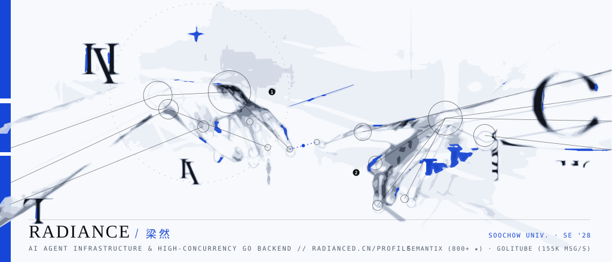

  

  苏州大学软件工程本科（2028 届），专注于 <strong>AI Agent 跨会话记忆基础设施</strong> 与 <strong>高并发分布式实时后端</strong>。 
  围绕上下文切片压缩、BM25+向量混合检索、结果复用依赖指纹验证，以及万级 WebSocket 长连接治理、Kafka 分区合批与容灾一致性构建可验证的工程系统。

  <a href="https://radianced.cn/profile"><strong>Personal Webpage (radianced.cn/profile) ↗</strong></a>
  &nbsp; · &nbsp;
  <a href="mailto:ranliang939@gmail.com">ranliang939@gmail.com</a>
  &nbsp; · &nbsp;
  <a href="https://github.com/radianceded?tab=repositories">Repositories</a>
  &nbsp; · &nbsp;
  Soochow University · Class of 2028

  <a href="#selected-work">Selected Work</a> &nbsp; / &nbsp;
  <a href="#experience">Experience</a> &nbsp; / &nbsp;
  <a href="#open-source">Open Source</a> &nbsp; / &nbsp;
  <a href="#toolkit">Toolkit</a>

---

## Selected Work

### 01 · [Semantix](https://github.com/Gnosil/semantix)

**AI Agent 跨会话记忆基础设施** · GitHub 800+ ★ · Top 1 Committer（96+ 已合并 PR）

- **记忆切片压缩与精简注入**：针对原方案直接注入 2–3KB 切片原文导致模型输出膨胀的问题，每条切片仅保留一句话动作、相对路径与验证命令，丢弃任务描述类切片并合并同文件重复项，总长压缩至 `≤1.8KB`，检索未命中时无损回退原提示词。在同批 12 题对照测试中，输出 Token 降低 **22.9%**，折算成本降低 **34.8%**。
- **BM25 + 向量双路融合检索与降级**：将 BM25 与稠密向量双路融合接入主动查询入口，支持按配置开启并在 Embedding 不可用时自动降级至 BM25。在 LoCoMo **5,882 个切片、1,977 道问题**对照测试中，Hit@10 从 **58.9% 提升至 70.0%**。
- **结果复用验证与文件依赖指纹校验**：实现「来源 → 模型 → 上下文 → 文件依赖」四级逐级校验，结合修改时间快速筛查与内容指纹验证，不满足条件时回退正常执行；在 **200 个任务**模拟评测中 **100% 拦截**全部依赖变更样例，有效结果复用率达 **85%**，命中任务耗时 P50 从 **12.0s 降至 0.8s**。

[浏览源码 →](https://github.com/Gnosil/semantix) &nbsp; · &nbsp; [查看我的提交 →](https://github.com/Gnosil/semantix/commits/main/?author=radianceded)

 

### 02 · [GoliTube](https://github.com/radianceded/GoliTube)

**Go 高性能直播弹幕后端系统** · `Gin` · `WebSocket` · `Kafka` · `Redis` · `MySQL`

- **高并发吞吐与尾延迟优化**：保持同步确认不变，实现 Kafka Producer 按分区合批、消费端 3 分区并行批量写库及房间级下行合包（50 条 / 20ms）。同机压测下千人热点单房间投递从 **4.1 万/秒升至 15.5 万/秒**（P99 **57.8s → 114ms**、0 缺失）；**2,000 TPS** 多房间 P99 从 **34.7s 降至 138ms**（0 积压），单机稳定维持 **15,000** 长连接。
- **并发连接治理与跨实例广播**：为每条连接设计 **256 条有界发送队列与单写协程**，广播非阻塞入队，队列满时淘汰慢客户端；结合 Ping/Pong 心跳与超时回收，通过 Redis Pub/Sub 支持多实例广播与房间隔离。
- **双层限流、可靠消费与版本化缓存**：实现连接级令牌桶（2 条/秒、突发 5 条）+ Redis 用户级窗口（跨实例 10 条/5 秒）双层限流；事件 ID 幂等与死信转存（DB 停服恢复后 **0 重复自动补存**）；事务提交后切换房间缓存版本并配置 `150ms` 缓存预算，隔离并发旧查询回填。

[浏览源码与压测报告 →](https://github.com/radianceded/GoliTube) &nbsp; · &nbsp; [在线演示 (radianced.cn) →](https://radianced.cn/)

 

---

## Experience

**上海确石人工智能有限公司（百度孵化）** · Agent 与后端开发实习生（2026.06 – 2026.09）

- **VLM + OCR 协同保险材料解析**：由 VLM 判断版式与朝向，结合 OCR 文本、坐标和原图联合抽取字段，经 Schema 与证据绑定校验，字段抽取准确率从 **83.3% 上升至 89.7%**（每页耗时 P50 `14.8s`）。
- **检索性能优化**：为 Embedding 添加进程内 `LRU + TTL` 缓存并隔离失败结果（连续 10 次相同查询实际调用降至 1 次）；在 5,000 条向量、K=10 测试下，TopK 比较次数由约 **5.5 万次降至 5,300 次**。
- **三级记忆召回降级**：设计「向量检索 → LIKE 全文检索 → 最近记录」三级降级并对齐跨模型向量维度，Embedding 全量故障注入下主对话成功率 **100%**，记忆召回非空率 **93%**。

 

---

## Open Source

CONTRIBUTIONS / 代码、实验与产品改进

### 已合并 / Merged

| Project | Contribution | PR |
| :--- | :--- | :--- |
| [prometheus/client_golang](https://github.com/prometheus/client_golang) | 微基准迁移到 `b.Loop`，统一基准用例命名 | [#2114](https://github.com/prometheus/client_golang/pull/2114) |
| [CherryHQ/cherry-studio](https://github.com/CherryHQ/cherry-studio) | 为 `~/.agents/skills` 同步增加按技能选择开关 | [#20356](https://github.com/CherryHQ/cherry-studio/pull/20356) |
| [zzet/gortex](https://github.com/zzet/gortex) | 修正模型价格配置及费用计算 | [#786](https://github.com/zzet/gortex/pull/786) |

<strong>进行中 / Open PRs</strong> — 展开查看 golang-migrate、OpenViking、AgentScope 与 GoFr

| Project | Proposed contribution | PR |
| :--- | :--- | :--- |
| [golang-migrate/migrate](https://github.com/golang-migrate/migrate) | 增加 `-database-env` 选项，从指定环境变量读取数据库连接 URL，减少命令行参数中的凭据暴露 | [#1461](https://github.com/golang-migrate/migrate/pull/1461) |
| [volcengine/OpenViking](https://github.com/volcengine/OpenViking) | 修复删除后的摘要刷新，以及 Windows 辅助文件 URI 路径处理 | [#6201](https://github.com/volcengine/OpenViking/pull/6201) · [#5531](https://github.com/volcengine/OpenViking/pull/5531) |
| [agentscope-ai/agentscope](https://github.com/agentscope-ai/agentscope) | 为 RealtimeAgent 增加上下文用量观测、后台压缩检查点、工具结果限长与重连恢复 | [#2838](https://github.com/agentscope-ai/agentscope/pull/2838) |
| [gofr-dev/gofr](https://github.com/gofr-dev/gofr) | 在 gRPC 指标标签中记录状态码 | [#4349](https://github.com/gofr-dev/gofr/pull/4349) |

[PR 详情清单 →](docs/open-source.md)

 

---

## Toolkit & Honors

- **竞赛奖项**：众安 AI Coding 大赛初赛 **冠军** · 松江区星火计划 OPC 创业挑战赛 **冠军** · 常熟 OPC 人工智能黑客松挑战赛 **亚军**

  
  
  
  
  
  

 

---

## Contribution Map

<picture>
  <source media="(prefers-color-scheme: dark)" srcset="https://raw.githubusercontent.com/radianceded/radianceded/output/github-snake-dark.svg" />
  <source media="(prefers-color-scheme: light)" srcset="https://raw.githubusercontent.com/radianceded/radianceded/output/github-snake.svg" />
  
</picture>
