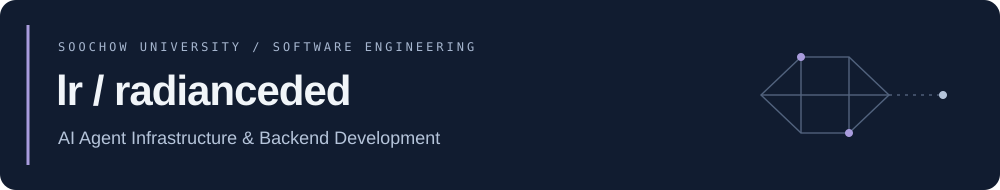

  

<h1 align="center">Hi, I'm lr / radianceded</h1>

  苏州大学软件工程本科生，关注 AI Agent 基础设施与后端开发。 
  参与过语义缓存、保险 Agent 和真实业务系统的开发与交付。

  <a href="mailto:ranliang939@gmail.com">ranliang939@gmail.com</a>
  &nbsp; · &nbsp;
  <a href="https://github.com/radianceded?tab=repositories">Repositories</a>
  &nbsp; · &nbsp;
  Soochow University · Class of 2028

  

## Selected Projects

### 01 · [Semantix](https://github.com/Gnosil/semantix)

**AI Agent 跨会话记忆与语义缓存** · 开源协作

让 Agent 复用跨会话的知识与工作流，减少重复探索和上下文开销。

- **我的参与：**上下文复用策略开发与实验验证。
- **关注的问题：**记忆复用的适用边界、执行开销与结果质量。

[Repository](https://github.com/Gnosil/semantix) · [My commits](https://github.com/Gnosil/semantix/commits/main/?author=radianceded)

### 02 · 保对了 / Baoduile

**保险垂类 Agent 应用** · 实习项目 · 私有仓库

面向保险业务中的信息提取与结构化处理，提升模型输出的可用性。

- **我的参与：**LLM 结构化输出校验与基于原文证据的保额纠错。
- **关注的问题：**金额数字漏位、单位归一化、主限额与子限额混淆，以及证据冲突时的保守处理。

仅展示项目概要。

### 03 · [Gathere](https://github.com/radianceded/Gathere)

**让多人聚会选址更公平** · 个人项目

结合参与者位置与出行方式，检索候选地点并比较通勤成本。

- **核心能力：**地图检索、路线规划，以及综合通勤时间与公平性差值的排序。
- **接入方式：**FastAPI、MCP Server 与聊天插件。

[Repository & documentation](https://github.com/radianceded/Gathere)

## Open Source

| Project | Contribution | Status |
| :--- | :--- | :--- |
| [prometheus/client_golang](https://github.com/prometheus/client_golang) | 微基准迁移到 `b.Loop`，统一基准用例命名 | [Merged · #2114](https://github.com/prometheus/client_golang/pull/2114) |
| [CherryHQ/cherry-studio](https://github.com/CherryHQ/cherry-studio) | 为 `~/.agents/skills` 同步增加按技能选择开关 | [Open PR · #20356](https://github.com/CherryHQ/cherry-studio/pull/20356) |

## Currently Building

**Go 直播弹幕后端 · 学习与开发中**

从零手写，逐步实现长连接管理、多房间广播与异步持久化，记录设计取舍和性能验证。

业务参考：[charlesAcmen/live-stream-danmaku](https://github.com/charlesAcmen/live-stream-danmaku)。阶段目标不代表已完成的功能或性能成果。

## Toolkit

**项目中使用**

  
  
  
  

**当前学习：**Go 网络编程 · WebSocket · MySQL · Redis · Kafka

## Contributions

<picture>
  <source media="(prefers-color-scheme: dark)" srcset="https://raw.githubusercontent.com/radianceded/radianceded/output/github-snake-dark.svg" />
  <source media="(prefers-color-scheme: light)" srcset="https://raw.githubusercontent.com/radianceded/radianceded/output/github-snake.svg" />
  
</picture>
